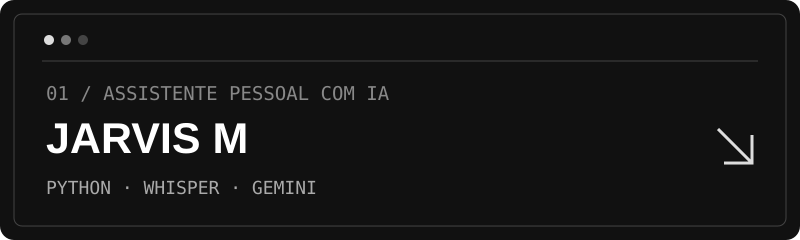
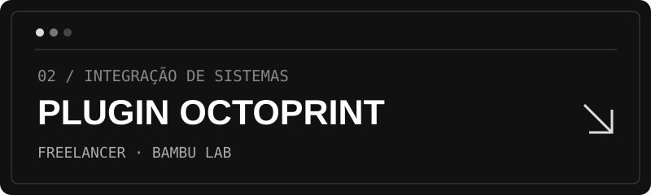
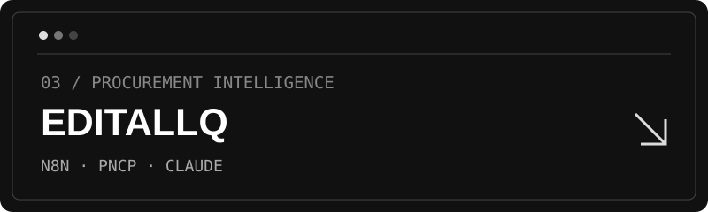

  
   
  
  
  
    
  

  

## About Me

I'm a software developer in training, focused on **AI-powered solutions, workflow automation, systems integration, and web applications**. I build projects independently using **AI-assisted development**, prompt engineering, and coding agents, combining technical planning, tool orchestration, testing, and iteration to turn ideas into working software.

- Currently pursuing technical education in **Digital Game Programming** and training in **AI-driven digital processes** at SENAI.
- Freelancing since **2026**, with experience across automation, software, web development, AI video production, and game development.
- Interested in **artificial intelligence, automation, and cybersecurity**.
- Working toward further professional experience and an internship after completing high school.

## Technical Skills

*The levels below describe my practical familiarity with tools and AI-assisted workflows; they do not imply that I write every implementation manually.*

| Area | Technologies and tools | Familiarity |
| --- | --- | --- |
| Game development | Godot Engine, GDScript | Advanced |
| AI & automation | n8n, AI agents, prompt engineering, Gemini API, local LLMs, Codex, Claude Code | Intermediate |
| Backend & integration | Python, Node.js, Express, REST APIs, webhooks, OAuth | Intermediate |
| Web & data | React, frontend design, database design, Supabase | Intermediate |
| Development workflow | Git, GitHub, VS Code, GitHub Desktop | Intermediate |
| Exploring | JavaScript, TypeScript, C#, HTML/CSS, SQL, Linux, cybersecurity fundamentals | Foundational |

## Featured Projects

### [JarvisM — AI Voice Assistant](https://github.com/matheusprtlh/JarvisM)

A personal voice assistant for Windows, created as an independent passion project. It combines wake-word activation, local speech transcription, AI-generated responses, text-to-speech, conversation history, and desktop actions such as launching applications and controlling volume.

**Stack:** Python · Whisper · Gemini API · Edge TTS · WebView2

### Plugin-Octoprint — Custom Systems Integration

A freelance integration project connecting the **Bambu Lab ecosystem** with a specialized web system used in a medical context. Built independently for a specific client workflow, with a focus on practical system interoperability.

**Status:** Project-specific freelance implementation. Repository access is currently private; public sharing is pending review.

### [EditallQ — AI-Assisted Procurement Monitoring](https://github.com/matheusprtlh/EditallQ)

An **n8n workflow prototype** that queries Brazil's PNCP public procurement data and uses AI to assess the relevance of opportunities. It extracts key procurement details and includes planned database persistence, deduplication, and WhatsApp notifications.

**Stack:** n8n · PNCP REST API · Claude AI · JavaScript · PostgreSQL · Evolution API  
**Status:** Work in progress; some integrations still require configuration and end-to-end testing.

## Experience

**Freelance Developer** · 2026–Present  
Independently developed client-specific software and integration solutions, alongside projects involving AI automation, web development, AI video production, and game development.

**AI Digital Processes — Apprentice Training** · SENAI · 2026–Present  
Currently in training; professional responsibilities and project outcomes will be added as they develop.

## Education & Certifications

- **Technical Program in Digital Game Programming** — SENAI FATESG · 2026–2027 (in progress)
- **AI Digital Processes Operator Training** — SENAI · 2026–2027 (in progress)
- **High School** — Expected graduation: 2027

**Additional completed training:** Intelligent Agents with n8n · Artificial Intelligence with Python · Illumi.ai · AI Development Assistant · Intelligent Agents Development Assistant · Cybersecurity Fundamentals · Industry Fundamentals · SESI/SENAI Experience Workshop

## Awards & Achievements

**GameGO Goiânia 2026 — SkyBound**  
Participated in the development of *SkyBound*, contributing to programming, art, and story direction. Reported team recognition includes **Best Game, Best Sound, Best Art, Best AI Integration, and Best Game Design**. Supporting award materials can be added here later.

## GitHub Activity

  
  

Statistics are provided by a third-party service and may occasionally be unavailable. Language charts reflect repository contents, not proficiency.

## Connect With Me

- [GitHub](https://github.com/matheusprtlh)
- LinkedIn and personal portfolio: coming soon.
